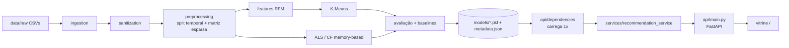

# Arquitetura

## Camadas
- **Pipeline offline** (`src/pipeline.py`): orquestra as etapas CRISP-DM com logs, escreve relatórios em `reports/` e artefatos em `models/`.
- **Modelos** (`src/models/`): CF memory-based, ALS (`implicit`), K-Means (Pipeline log1p + StandardScaler), híbrido.
- **Serviço** (`api/services/`): regra de negócio sem dependência de framework — escolhe a estratégia, filtra por estoque (busca 4×k candidatos e prioriza itens disponíveis), monta o segmento.
- **Rotas** (`api/main.py`): validação (Pydantic), erros HTTP (503 se não há modelo, 422 para k inválido).

## Decisão do híbrido
Qualquer usuário com ≥1 item no treino usa ALS; sem histórico cai no top do maior cluster. Um limiar 3 foi testado e piorou o nDCG dos usuários com pouco histórico de 0,0195 para 0,0032 (`reports/strategy_comparison.csv`).

## Versionamento de modelo
Cada execução grava `models/metadata.json` (versão por timestamp, commit git, parâmetros, métricas, tamanhos) e acrescenta uma linha a `models/registry.jsonl`. A API expõe isso em `/model`.

## Configuração
Diretórios sobrescrevíveis por `RECSYS_DATA_DIR`, `RECSYS_MODELS_DIR`, `RECSYS_REPORTS_DIR` (usado nos testes para isolar o pipeline).
